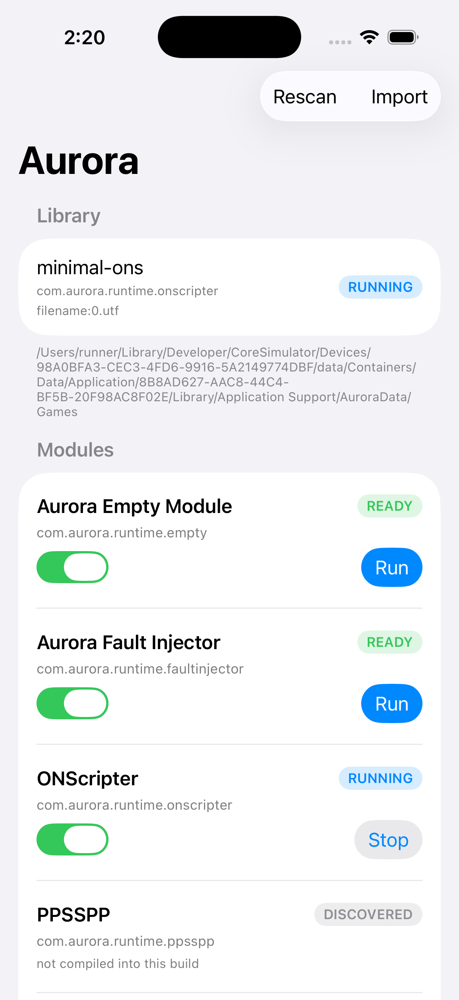

# 14 ONScripter 接入设计

## 1. 引擎的运行方式（读源码得到的事实）

$onscripter.cpp$ 的入口是：

$cpp
ONScripterLabel ons;
parseOptionFile(CFG_FILE, ons, hasArchivePath);
parseOptions(argc, argv, ons, hasArchivePath);
for (;;) {
    if (ons.init()) exit(-1);
    ons.executeLabel();   // 整个游戏循环，阻塞到脚本结束
    SDL_Quit();
}
$

$executeLabel()$ 不返回，直到脚本结束或收到退出。这是**阻塞式主循环**，
和我们"平台每帧调 tick"的模型天然冲突。

参考实现（2017 年的 ONScripter-iOS 移植，third_party/onscripter-ios-old）是这么做的：

$objc
_onscripter = new ONScripter();
_onscripter->setArchivePath(...);
_onscripter->setSaveDir(...);
_onscripter->openScript();
_onscripter->init();
SDL_iPhoneSetEventPump(SDL_TRUE);
_onscripter->executeLabel();   // 阻塞
$

它依赖 SDL 1.2 的 $SDL_iPhoneSetEventPump$（SDL2 里没有）。

## 2. 三条路（读完 executeLabel 源码后修正）

@@@executeLabel()@@@ 的循环是**逐条解析脚本命令**，不是逐帧：

@@@cpp
while (current_line < current_label_info.num_of_lines) {
    if (SDL_PumpEvents(), SDL_PeepEvents(NULL, 1, SDL_PEEKEVENT, SDL_QUITMASK))
        endCommand();
    int ret = ScriptParser::parseLine();
    if (ret == RET_NOMATCH) ret = this->parseLine();
    ...
}
@@@

关键在于：引擎的"等待"发生在**命令内部**（显示文字后等点击、等待动画等），
主循环本身并不按帧返回。所以"每帧调一次 step"不是一个能简单切出来的函数——
要做就得把 wait/event 那一整套逻辑改成分段状态机，侵入性太大。

| 方案 | 做法 | 结论 |
|---|---|---|
| A. 引擎跑在自己的线程 | 主线程建 SDL 窗口，引擎线程跑 executeLabel，输入用 SDL_PushEvent 投递 | **采用**：不改上游，先跑起来 |
| B. 给引擎加单步接口 | 把 executeLabel 拆成每帧返回 | 否决：循环卡在命令内部，改动面比想象大得多 |
| C. 独立进程 | iOS 不可行 | 排除 |

也就是说：ONScripter 这类"自带主循环"的引擎，**平台让出控制权**，
模块负责自己的线程与窗口；平台只做生命周期、输入投递、音频与存储。
这与"平台驱动 tick"的模拟器模块是两种形态，ABI 里 @@@tick@@@ 是可选回调正是为此留的口子。

## 3. 与 Aurora 的接线

$
Aurora App (SwiftUI)
  └─ 模块 com.aurora.runtime.onscripter
       ├─ create_instance: 存 host 指针
       ├─ load_game: 记录脚本目录
       ├─ start: 主线程 SDL_Init(VIDEO|AUDIO)，起引擎线程
       ├─ tick: 帧计数 / 状态汇报（方案 B 后改为驱动引擎）
       └─ stop: 投递 SDL_QUIT，等线程退出
$

画面：方案 A 阶段由 SDL 自己开窗；方案 B 阶段改为引擎把像素交回
$acquire_frame$，走我们统一的 Metal 通道。
音频：先用 SDL_mixer 的 CoreAudio 输出，后续迁到 $audio_submit$。

## 4. 当前阻塞

- SDL 全套（SDL2 + sdl12-compat + image + ttf + mixer）的 iOS 构建 spike 在跑
- GitHub API 时不时连不上，需要重试；构建产物走 artifact 下载可用

## 5. 模块骨架（已写，未接入构建）

@@@
Modules/ONScripter/src/
  ons_engine.h             Aurora 与引擎的唯一接缝
  ons_engine_stub.cpp      没链接引擎时返回 UNSUPPORTED（不会假装能跑）
  onscripter_module.cpp    ABI 适配：start 起线程、tick 观察、stop 投递退出
@@@

这两个文件已用本地编译器单独验证能编过（不许接入 modules.list，
否则构建表会指向一个不存在的符号）。
接引擎时要做的是：把 @@@ons_engine_stub.cpp@@@ 换成真正的 ONScripter 实现，
并把模块加进 @@@Modules/modules.list@@@。

## 6. 依赖栈的路线选择（2026-11-09 实测后改）

原计划：Galladite 版 ONScripter-EN + SDL2 + sdl12-compat + SDL2 的插件库。
CI 跑下来撞到两堵墙：

1. **头文件互斥**：sdl12-compat 的兼容头是"最小集"，而 SDL2 的 SDL_image/ttf/mixer 头会拉 SDL2 的核心头，
   同一个编译单元里 `SDL_bool`、`SDL_ltoa` 全体重定义。ONScripter 必须配 SDL **1.2 版**的插件库头。
2. **SMPEG 版本对不上**：引擎调用
   `SMPEG_setdisplay(mpeg, surface, lock, cb)`、`SMPEG_scaleXY`、`SMPEG_move`，
   这是 ONScripter 自己改过的 SMPEG；icculus/smpeg 和 y2017 移植里那份都是回调式 API，签名不同。
   另外 sdl12-compat 的兼容头还缺 `SDL_AudioFormat`、`SDL_CreateThread` 也变成了三参数。

结论：**改用 yeatse/ONScripter-iOS 那套自洽的栈**（SDL 1.2 + SDL_image/ttf/mixer 1.2 + smpeg + ONScripter），
它本来就是为了在 iOS 上跑而拼起来的，版本互相匹配。核心换成 SDL 1.2（带 UIKit 后端），
我们的模块只负责生命周期与输入投递，渲染由引擎自己开窗。

代价：引擎版本偏老（2017），不如 EN 分支新；但"能跑起来"的确定性高得多。

## 7. 第三次选路：ONScripter-RU（2026-11-09）

2017 那套移植的工程文件已经失效（引用的 `SDL/Xcode-iOS/SDL/SDL.xcodeproj` 根本不存在，
SDL_image/ttf/mixer 的 iOS 工程路径也是空的），lua 的 `loslib.c` 还在用被 iOS 禁掉的 `system()`。
继续修它等于重写一套构建系统。

查到的现成经验：

- **umineko-project/onscripter-ru** —— 《海猫》移植组维护的引擎，编译文档明确写了
  "iOS 8.0 (armv7, armv7s, aarch64)"，构建栈是 Xcode + 自带依赖系统 onscrlib，
  而且是 **SDL2 原生**（不需要 sdl12-compat，也就没有 SMPEG 那套版本地狱）。
- uyjulian/onscripter 的 sdl2 分支（仓库已不可访问）。

**决定：以 ONScripter-RU 为基础做第一个可跑引擎。** 我们的 SDL2 静态库已经能编出来了，
但 RU 附带自己的依赖构建系统，先按它的路子走，跑通后再决定要不要换成我们自己的 SDL2。

风险：onscrlib 是 2018 年的脚本，面向 macOS 10.6/32 位，现代 Xcode 可能编不动；
需要先做一次 CI 探针，确认它的依赖到底能不能在当前 Xcode 上构建。

## 8. 依赖栈全部打通（2026-11-09）

@@@ons-spike@@@ 现在一次构建产出全部 17 个静态库：
引擎 @@@libaurora_onscripter.a@@@，核心 @@@libSDL2.a@@@ / @@@libSDL-1.2.a@@@，
插件 @@@libSDL_image.a@@@ / @@@libSDL_ttf.a@@@ / @@@libSDL_mixer.a@@@，
依赖 @@@libpng.a@@@ / @@@libjpeg.a@@@ / @@@libfreetype.a@@@ / @@@libogg.a@@@ / @@@libvorbis*.a@@@。

踩过的三个坑记在这里：

1. **libjpeg-turbo 的 CMake 在 Xcode 生成器下会空变量**
   （@@@string(TOLOWER ${CMAKE_SYSTEM_PROCESSOR} ...)@@@）→ 必须显式传
   @@@-DCMAKE_SYSTEM_PROCESSOR=arm64@@@ 和 @@@-DCMAKE_BUILD_TYPE=Release@@@。
2. **浅克隆没有 git tag**，而它从 tag 推版本号 → 钉 @@@--branch 3.0.4@@@。
3. **freetype 的 HarfBuzz 可变字体模块（hvf）要单独关**：`FT_DISABLE_HARFBUZZ` 不管它，得 `FT_DISABLE_HVF`。
4. **sdl12-compat 留了两个外部钩子**给应用实现：@@@error_dialog@@@ 和
   @@@SDL12COMPAT_NSLog@@@（后者本来在 Cocoa 胶水里，iOS 不编那份）。

## 9. 链接成功，等真机验证（2026-11-09）

App 现在能把整条栈装进去：iOS 构建产物里的可执行文件 2.07 MB，
用字符串检索确认含有 @@@com.aurora.runtime.onscripter@@@、@@@ONScripterLabel@@@、@@@SDL_Init@@@。

在此之前链接卡过的符号，按出现顺序记一遍，免得以后重复踩：

| 缺的符号 | 原因 |
|---|---|
| @@@error_dialog@@@ / @@@SDL12COMPAT_NSLog@@@ | sdl12-compat 留给应用实现的两个钩子 |
| @@@HVF_*@@@ | freetype 的可变字体模块，@@@FT_DISABLE_HARFBUZZ@@@ 关不掉，要 @@@FT_DISABLE_HVF@@@ |
| @@@IMG_Load*@@@ | SDL_image 在 Apple 上默认编掉纯 C 加载器，要 @@@SDL_IMAGE_USE_COMMON_BACKEND@@@ |
| @@@IMG_InitTIF/WEBP@@@ | @@@IMG_Init@@@ 无条件引用，我们没编这两个加载器 → 补空实现 |
| @@@ov_*@@@ | 只链了 @@@libvorbis@@@，少了 @@@libvorbisfile@@@ |
| @@@getResource@@@ | 引擎预期由平台构建提供，我们返回 @@@nullptr@@@ |

### 真机验证步骤

1. 用 Sideloadly 签这个 ipa 并安装（需要本人 Apple ID 口令，我这边没法代填）。
2. 把 @@@TestGames/minimal-ons/@@@ 放进 App 的 @@@Documents/Games/@@@（文件 App 或 iTunes 文件共享）。
3. App 里 Rescan → 库列表应出现 @@@0.txt@@@ → 选中 ONScripter 模块 → Start。
4. 预期看到两行 ASCII 文本，点两下结束。

## 10. 运行时验证进展（2026-11-09，模拟器）

为了不把"跑起来"这件事全押在人工装包上，加了 @@@ons-sim@@@ 工作流：
用 @@@iphonesimulator@@@ SDK 编一套 x86_64 的完整栈，再在 CI 的 macOS runner 上
启动模拟器、装 App、用 @@@AURORA_AUTOSTART@@@ 自动拉起 ONScripter 模块，
最后把引擎的 stderr 和系统日志写进 @@@ci-status/@@@@。

已经实测到的（第 19 轮）：

@@@
[onscripter] script directory: .../AuroraData/Games/minimal-ons
Script found: .../AuroraData/Games/minimal-ons/0.txt
Adding path: .../RuntimeModules/com.aurora.runtime.onscripter/Saves/
***[Fatal] Init Error: Couldn't initialize SDL ***
@@@

也就是说：导入 → 库识别 → 模块加载 → 脚本定位 → 存档目录，整条管线通了；
卡在 @@@SDL_Init@@@。原因是 SDL2 要求 @@@"main 由 SDL 提供"@@@，嵌入宿主时要先
@@@SDL_SetMainReady()@@@。这一条已加，但 sdl12-compat 的兼容头没有它的声明，
得自己 @@@extern "C"@@@ 声明一次（符号来自链接的 SDL2）。

顺带在这个过程里发现一个真机也会中的问题：**sdl12-compat 在 Apple 上不做静态链接**，
它用 @@@dlopen("@executable_path/libSDL2-2.0.0.dylib")@@@ 找 SDL2，所以全静态链接会
在运行时直接报 @@@"Failed loading SDL2 library"@@@。现在 SDL2 同时产出动态库，
打包时放到可执行文件旁边。

还没验证完的：SDL 初始化之后的部分（窗口、渲染、脚本执行）。
真机安装仍然需要本人 Apple ID 口令，模拟器验证是它的替代证据。

### 模拟器实拍（2026-11-09）

截图里可以看到：库列表识别出 @@@minimal-ons@@@（@@@filename:0.utf@@@），
模块列表里 ONScripter 状态是 **RUNNING**，按钮变成 Stop。
配合日志里的 @@@video driver: uikit surface: 640x480@@@ 和引擎线程行，
说明模块确实加载并执行了这个脚本。

还没做到的：**游戏画面没有出现在屏幕上**。App 自己的列表占满屏幕，
SDL 建立的那层 UIWindow 没有可见地叠在上面。这是下一步要解决的
（要么让 SDL 的视图嵌进 SwiftUI，要么把 UIImage 路径接上）。
